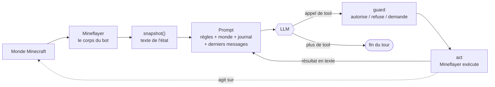
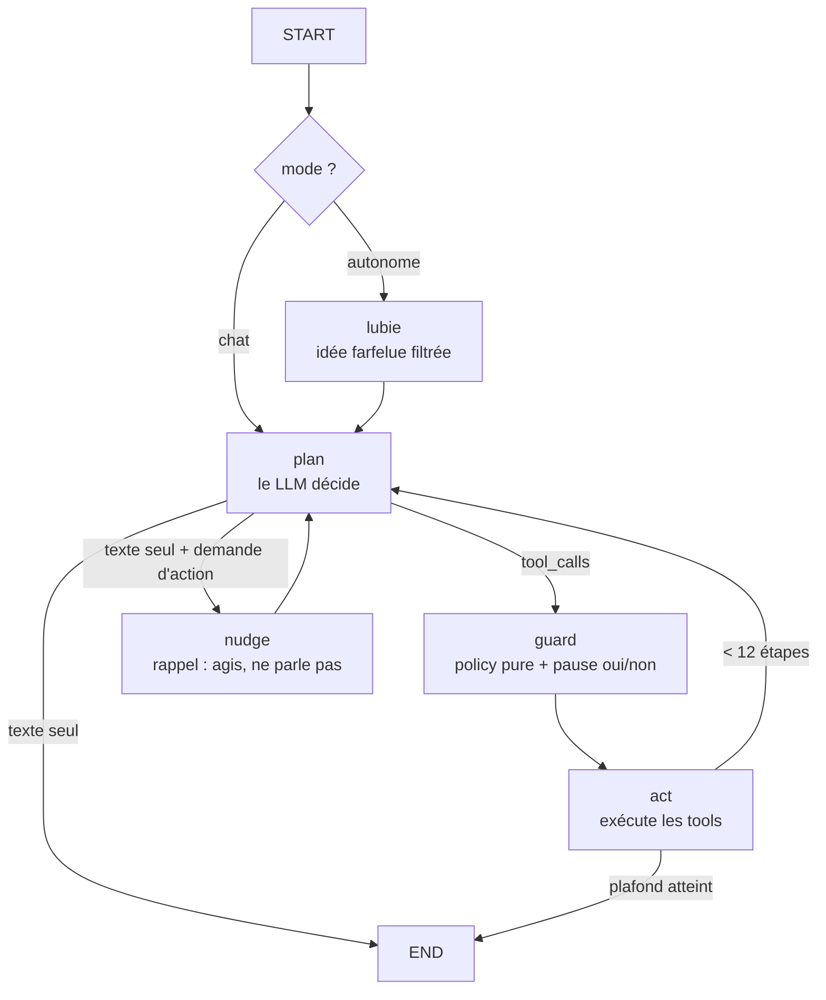
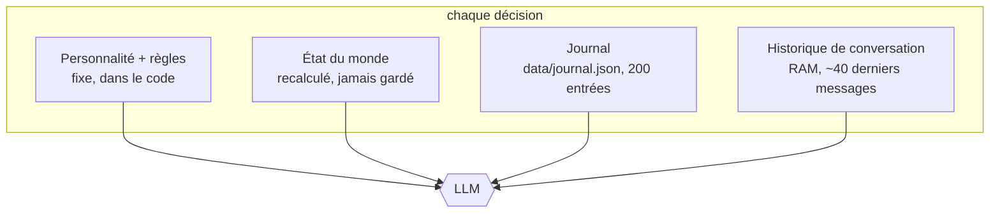

# Minecraft Companion

Un compagnon Minecraft **agentique** : cerveau LangGraph.js + un LLM au choix, corps Mineflayer, constructions déterministes en datapack.

Première version : il mine, récolte du charbon, de la pierre ou du bois sur demande, mange, dort la nuit, sort d'un trou et construit quelques structures.

## Comment il pense

Le modèle ne voit ni image ni 3D : à chaque décision il reçoit **du texte** (règles, état du monde, journal, derniers messages) et répond en **appelant des tools**. Le résultat du tool revient en texte, et la boucle continue.



Le graphe LangGraph (`src/graph.ts`) :



- **plan** : le LLM décide et appelle des tools.
- **guard** : politique pure (`src/policy.ts`), sans effet de bord. Autorise, refuse, ou **met le graphe en pause** (`interrupt`) pour demander "oui/non" au joueur.
- **act** : exécute les tools autorisés, renvoie les refus au modèle comme `ToolMessage` d'erreur.
- **nudge** : si tu demandes une action ("mine", "va", "dors"...) et que le modèle se contente de répondre en texte, il est relancé **une fois** pour qu'il agisse vraiment.
- **lubie** : quand tu n'as rien demandé depuis `IDLE_AFTER_SECONDS`, un modèle invente une idée ; elle est écartée si `risk = high`, puis exécutée avec une **allowlist réduite** de tools.
- **Constructions** : `run_blueprint` vérifie l'inventaire, le datapack le revérifie, retire les matériaux (`clear`), puis place la structure. Le LLM choisit *quoi/quand/où*, jamais *comment*.

## Ce qu'il voit

| Source | Contenu |
|---|---|
| `snapshot()` (injecté à chaque décision) | position, vie, faim, jour/nuit, objet en main, relief (suis-je dans un trou ?), menaces, joueurs, inventaire |
| `look_around` | lits, coffres, établis, minerais, arbres, lave/eau, animaux, menaces, objets au sol dans un rayon de 4 à 32 blocs |
| `find_block` | coordonnées des blocs les plus proches d'un type (nom exact ou partiel : `coal_ore`, `bed`, `log`) |

Il **ne voit pas** les blocs un par un : s'il ne regarde pas autour de lui (`look_around`, `find_block`), il ne sait pas ce qui l'entoure.

## Sa mémoire



| Couche | Durée | Contenu |
|---|---|---|
| Règles et personnalité | permanente (code) | `src/prompts.ts`, `PERSONALITY` |
| État du monde | un tour | `snapshot()` |
| Journal | disque, survit au redémarrage | tes messages, lubies, constructions, lits utilisés, tunnels creusés, notes (`remember`) |
| Historique | RAM, perdu au redémarrage | derniers messages et résultats de tools |

Pas encore de mémoire structurée (position de la mine, des coffres, objectif courant) : c'est la prochaine étape.

## Les tools

| Tool | Rôle | Vérifie le résultat réel |
|---|---|---|
| `say` | parler dans le chat | – |
| `get_status`, `look_around`, `find_block` | percevoir | – |
| `go_to_player`, `go_to` | se déplacer | distance restante ("Arrivé" ou "Pas arrivé") |
| `collect_block` | miner/couper un type de bloc | différence d'inventaire |
| `mine_tunnel` | tunnel ou escalier descendant à la pioche, ramasse les minerais voisins | différence d'inventaire, raison d'arrêt (lave, eau, vide, monstre, vie basse) |
| `sleep_in_bed` | aller dormir (nuit ou orage) | `bot.isSleeping` |
| `dig_out` | sortir d'un trou ou d'une mine | profondeur avant/après |
| `eat` | manger la meilleure nourriture | niveau de faim avant/après |
| `equip_item` | main ou armure | slot réellement équipé |
| `craft_item`, `give_to_player` | fabriquer, donner | différence d'inventaire |
| `list_blueprints`, `run_blueprint` | constructions (accord oui/non) | matériaux consommés |
| `remember`, `emote`, `wander` | journal, animations, balade | – |

Garde-fous (`src/policy.ts`) : blocs protégés (coffres, fours, lits...), zone `HOME_*` intouchable, longueur de tunnel plafonnée, mode autonome limité à une allowlist, seul `OWNER_USERNAME` donne des ordres.

## Installation

1. **Node.js 20+** (`node -v`).
2. `npm install`
3. `cp .env.example .env` puis choisis ton fournisseur (voir « Choisir le modèle »), et idéalement `OWNER_USERNAME` (ton pseudo).
4. **Serveur Minecraft Java** local (jar vanilla ou Paper), dans `server.properties` : `online-mode=false`.
   Le bot se connecte en mode offline ; ne mets pas ce serveur en ligne tel quel.
5. Copie `datapack/companion/` dans `<monde>/datapacks/`, puis `/reload` en jeu.
6. Dans la console du serveur : `op Compagnon` (le bot a besoin du niveau op pour lancer `/function`).
7. `npm start`, puis parle dans le chat.

Versions : Mineflayer 4.39 gère jusqu'à Minecraft 26.1. Le `pack.mcmeta` vise large (`pack_format` 48 + plage) ; si le jeu signale le pack comme incompatible, ajuste ses numéros de format pour ta version.

## Choisir le modèle

Dans `.env` : `LLM_PROVIDER` + `COMPANION_MODEL` (+ la clé du fournisseur).

| Fournisseur | `LLM_PROVIDER` | Clé | Remarque |
|---|---|---|---|
| OpenRouter | `openrouter` | `OPENROUTER_API_KEY` | un seul compte, beaucoup de modèles |
| Google AI Studio | `google` | `GOOGLE_API_KEY` | modèles Gemini |
| Ollama (local) | `ollama` | aucune | le modèle doit supporter les **tools** |
| Anthropic | `anthropic` | `ANTHROPIC_API_KEY` | optionnel |

**Le modèle compte beaucoup.** Un agent enchaîne plusieurs appels de tools, lit leurs résultats et corrige le tir : les petits modèles (≈ 20 milliards de paramètres ou moins) inventent, bavardent au lieu d'agir et se contredisent. Vise un modèle réputé pour le *tool calling* (par exemple `google/gemini-2.5-flash` sur OpenRouter) ; garde le petit modèle pour `COMPANION_IDLE_MODEL` (les lubies).

`LLM_TEMPERATURE=0.4` donne un comportement plus sage que 0.7.

**Local avec Ollama** : `ollama pull <modele>`, puis `LLM_PROVIDER=ollama`. Minecraft partage ta carte graphique : garde de la marge de VRAM
(avec 8 Go, vise un modèle de 4 à 8 milliards de paramètres, plutôt quantifié) et attends-toi à plus d'erreurs de tools.
Les `<think>…</think>` des modèles à raisonnement sont retirés des messages relayés dans le chat.

## Essayer

- `viens ici`, `mine ici` / `mine avec ta pioche`, `va chercher du charbon`, `récolte 20 pierres`
- `regarde autour de toi`, `où est le lit ?`, `mange`, `sors du trou`
- La nuit : `viens dormir` (il va au lit le plus proche ; la nuit ne passe que si tous les joueurs dorment)
- `construis une ferme à poules` : il liste les matériaux, les récolte, te demande "je la mets ici ?", puis construit.
- Ne dis rien pendant 90 s : il improvise.

## Ajouter un tool / une construction

- **Tool** : ajoute un `tool({...})` dans `src/tools.ts` (schéma zod) qui **vérifie ce qui s'est vraiment passé** et le dit dans son résultat. S'il est inoffensif, ajoute son nom à `IDLE_TOOLS` dans `src/policy.ts`.
- **Garde-fou** : une règle de plus dans `checkToolCall` (`src/policy.ts`), testable sans Minecraft.
- **Construction** : une entrée dans `src/blueprints.ts` + deux fichiers dans `datapack/companion/data/companion/function/` (`build/x.mcfunction` pour vérifier et payer, `internal/x_place.mcfunction` pour placer). Garde les coûts synchronisés.

## Tests

```
npm run typecheck
npm test
```

Les tests couvrent la politique, le graphe (pause humaine, refus, allowlist autonome, plafond d'étapes, relance "agis") et le câblage des fournisseurs, avec des modèles scriptés : pas de réseau, pas de serveur. Les tools Mineflayer eux-mêmes se testent en jeu.

## Pistes

- Mémoire structurée : où est la mine, les coffres, le lit, le dernier objectif.
- Survie : se mettre à l'abri des monstres (`take_shelter`), chasser pour manger, combattre.
- Poser des torches dans les tunnels, stocker dans un coffre.
- Animation de construction bloc par bloc (`schedule function`), plus de blueprints.
- Persistance du checkpointer (SQLite) pour reprendre une conversation après redémarrage.
